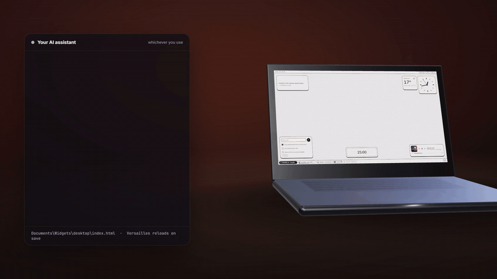
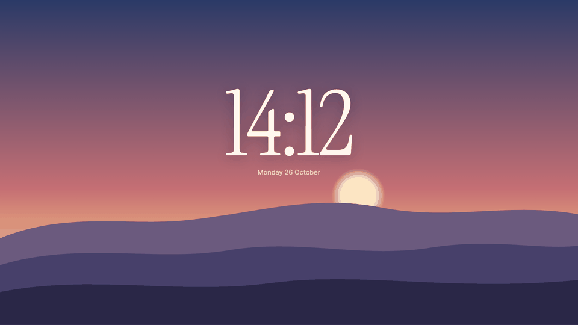
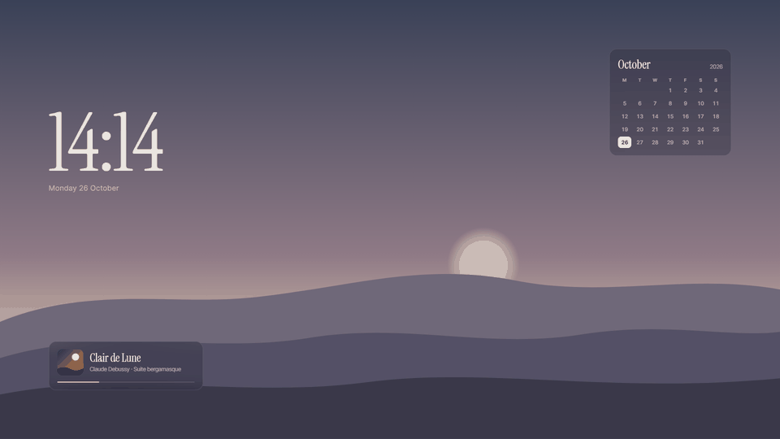
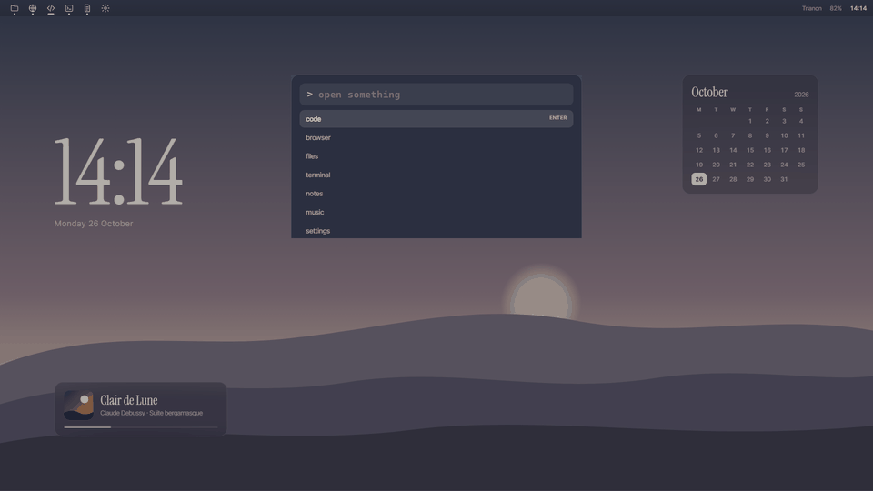
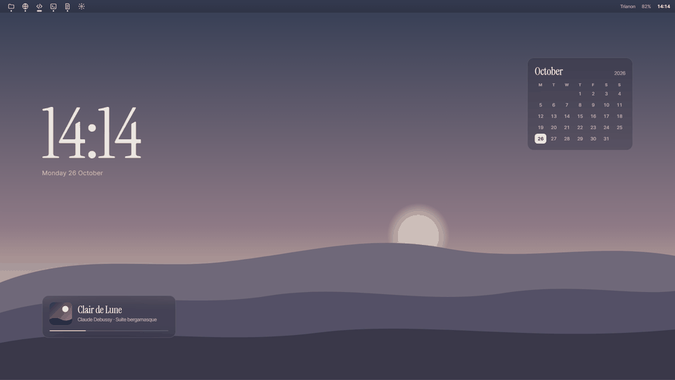
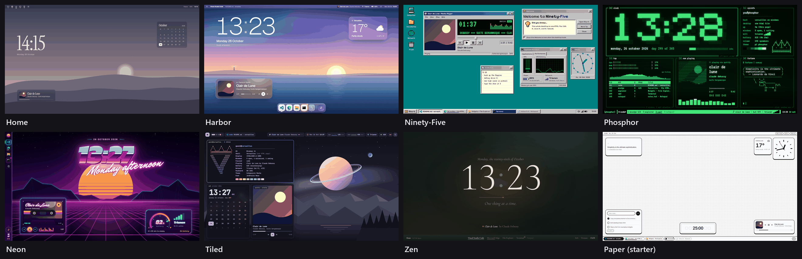

<h1 align="center">Versailles</h1>

<p align="center"><b>Your PC. Your palace.</b><br>Make your Windows desktop look and work the way you want.</p>

<p align="center">
  <a href="https://github.com/crasyK/versailles/releases/latest"></a>
  
  <a href="LICENSE"></a>
</p>

<p align="center">
  <b><a href="https://github.com/crasyK/versailles/releases/latest">Download</a></b> ·
  <a href="docs/GETTING-STARTED.md">Getting started</a> ·
  <a href="docs/ASSISTANT.md">Design it with an AI assistant</a> ·
  <a href="examples/showcase">Starting points</a>
</p>

<p align="center">
  
</p>

Versailles puts your own design on the Windows desktop: the wallpaper and what sits on it, the bars along the edges, and the windows a key brings up. Windows and your apps stay as they are.

## Change as little or as much as you like

<table>
  <tr>
    <td width="50%"></td>
    <td width="50%"></td>
  </tr>
  <tr>
    <td><b>A background and a clock.</b> That can be the whole thing.</td>
    <td><b>A few widgets</b> that make it useful: what's playing, your calendar.</td>
  </tr>
  <tr>
    <td width="50%"></td>
    <td width="50%"></td>
  </tr>
  <tr>
    <td><b>A keyboard launcher</b> on the Windows key: type, arrow, Enter. Start stays a shortcut away (Ctrl+Esc).</td>
    <td><b>Your own bar</b> with icons for the apps you use every day, in place of the taskbar if you want.</td>
  </tr>
</table>

Each of these is a stopping point, not a level. Someone who only wanted the clock got what they came for.

## Shape it in a conversation

Tell your AI assistant what you want, look at it, and keep going:

> "A calm background with a big clock."
> "A little quieter."
> "Move the clock to the left."
> "Put my daily apps along the top."
> "Actually, keep the normal taskbar."

The desktop above was made exactly like that. Each answer is a new version of one page, `Documents\Widgets\desktop\index.html`. Paste it in and save, and Versailles reloads it (an assistant that can edit files can save it for you). Versailles has no chat of its own: use the assistant you already have, and give it [the brief](docs/ASSISTANT.md) first so it knows how the page talks to Windows. A nice-looking web page is not yet a working desktop.

Prefer to do it yourself? The page is plain HTML, CSS and JavaScript, with no build step. Start from the [starter](templates/starter) or a [starting point](examples/showcase), and follow [Getting started](docs/GETTING-STARTED.md).

## It works, not just looks

The page can do what your desktop does. It can launch your apps, switch and close windows, show what's playing, and change Wi-Fi, Bluetooth, volume, brightness and night light. Each piece of the page gets only the Windows features it asks for. Settings change only from a bar or a pop-up window, inside a click.

If you take the taskbar's place, your bar can have window buttons, live previews, the tray icons, progress bars and jump lists. Explorer keeps running underneath, and Start, Win+A and notifications keep working.

## Starting points

<p align="center"></p>

Every desktop here is a page in [`examples/showcase`](examples/showcase) (the Paper starter is in [`templates/starter`](templates/starter)). Copy one to `Documents\Widgets\desktop\index.html`, then make it yours. Ninety-Five, Phosphor, Neon and Tiled bring their own taskbar and hide the Windows one; delete the `hideTaskbar` line in the page if you don't want that.

## Install

Download `Versailles_x.y.z_x64-setup.exe` from the [latest release](https://github.com/crasyK/versailles/releases/latest). It needs Windows 11 (64-bit) and no administrator rights. On first start, a welcome window offers to set up the starter desktop.

> [!WARNING]
> The installer is not code-signed, so Windows SmartScreen warns first (**More info** → **Run anyway**). If **Smart App Control** is on, it blocks Versailles outright; read [the install notes](docs/GETTING-STARTED.md#install) before you decide to switch it off. Updates installed later from the tray are verified against a key built into the app.

## If you change your mind

- **Quit** from the tray menu, and the Windows taskbar comes back at once. It also comes back if Versailles crashes or is ended, and at the next sign-in after a power cut.
- Uninstalling puts it back too. Your page stays in `Documents\Widgets`.
- Versailles 1.x keeps the page format and the API stable ([COMPATIBILITY.md](COMPATIBILITY.md)). Windows itself is outside that promise: some integrations use undocumented Windows features, and a Windows update can change or remove them.
- Resources: on the development laptop, with a test page that reads every sensor, Versailles itself uses about 34–43 MB and its WebView2 (Edge) processes about 270 MB together. The plain starter idles at about 1 % of one CPU core; animated wallpapers cost more ([measurements](CONTRIBUTING.md)).

## Everything a page can do

- **Wallpaper widgets** on every monitor or on the ones you name.
- **Pop-up windows and slide-outs**, anchored to a corner, an edge, the centre or the cursor, each with its own hotkey, including the **Windows and Copilot keys**.
- **Docked bars** (top bar, taskbar, dock, side rail) that reserve their strip like the taskbar, float, or auto-hide; one copy per monitor if you like.
- **Your own taskbar**: window buttons, live hover previews, attention, apps' progress bars and badges, jump lists, the tray icons and a keyboard-layout pill.
- **Quick settings**: Wi-Fi networks, Bluetooth devices (and pairing new ones), volume, microphone and a per-app mixer, brightness, night light, projection, power mode, Do Not Disturb, notifications, Windows VPN profiles, the mobile hotspot, Cast and nearby sharing, accessibility toggles.
- **System readings**: battery, network, the focused window, audio, what's playing, notifications, the tablet posture of a convertible, the keyboard layout.
- **A command bar** in the starter page: apps (Store apps included), Settings pages by name, Windows Search, recent files, shortcuts, PowerShell and a terminal.
- **Between pieces**: per-piece storage, a message bus, data handed to a pop-up as it opens.
- **A stable API**: 33 hooks, a page SDK with TypeScript types, one error shape, frozen for 1.x ([COMPATIBILITY.md](COMPATIBILITY.md)).
- **Permissions per piece**: a piece gets only the hooks it lists; web sites and other apps cannot use Versailles to get more than they already have. The page itself is trusted code, so only run pages you trust ([SECURITY.md](docs/SECURITY.md)).

## How a page is built

Widgets are `article.widget`; bars and pop-ups are `template.spawnable`. A few `data-*` attributes say where they go, and `data-hooks` says what each piece may ask Windows for:

```html
<!-- a card on the wallpaper -->
<article class="widget" data-id="song" data-hooks="media">…</article>

<!-- a bar along the top of every monitor; maximized apps stop below it -->
<template class="spawnable" data-id="topbar" data-anchor="top" data-h="44"
          data-monitor="all" data-hooks="shell,windows,battery">…</template>

<!-- a launcher on the Windows key -->
<template class="spawnable" data-id="launch" data-anchor="tc" data-w="640" data-h="360"
          data-hotkey="Win" data-hooks="hotkey,shell">…</template>
```

```js
versailles.for("song").media.onChange((m) => (title.textContent = m.title));
filesButton.onclick = () => versailles.for("topbar").shell.open("shell:MyComputerFolder");
```

## Documentation

| | |
| - | - |
| [Getting started](docs/GETTING-STARTED.md) | Install, the starter, editing live, your first widget, bar and hotkey pop-up, hiding the taskbar, updating, uninstalling |
| [Design it with an AI assistant](docs/ASSISTANT.md) | The conversation, step by step, and the brief to give your assistant |
| [Cookbook](docs/cookbook/README.md) | Recipes: a top bar, a taskbar, quick settings, a command bar, tablet posture, storage, talking between pieces |
| [DIALECT.md](docs/DIALECT.md) | Reference: classes, `data-*` attributes, placement, docked bars, monitors, the `#versailles` config |
| [HOOKS.md](docs/HOOKS.md) | Reference: every hook, the SDK, payloads, errors, hook classes |
| [RUNTIME.md](docs/RUNTIME.md) | The local file server and API, config files, crash recovery, diagnostics, updates |
| [SECURITY.md](docs/SECURITY.md) | Threat model: what Versailles protects, from whom, and what it leaves to you |
| [COMPATIBILITY.md](COMPATIBILITY.md) | What 1.x guarantees, deprecations, versioning |
| [CHANGELOG.md](CHANGELOG.md) | What changed in each release |
| [`examples/`](examples) | Starting points, widgets and pop-ups to copy into your page |

## Develop

Requirements: Node 22, Rust (stable), the WebView2 runtime (part of Windows 11).

```bash
npm install
npm run tauri:dev
```

Or run [`dev.cmd`](dev.cmd), which puts `%USERPROFILE%\.cargo\bin` on the `PATH`. The dev build serves the same `Documents\Widgets` folder on port 47831.

- `templates/starter/` is the example desktop the app ships and copies on first run. Its command bar, `desktop/bar.js`, is generated from [`src/launcher.ts`](src/launcher.ts) with `npm run build:bar`. The page SDK is [`templates/starter/.sdk/versailles.js`](templates/starter/.sdk/versailles.js) (plain script, no build step) with its types next to it.
- Checks: `npm run verify:acl` (Tauri permissions), `npm run verify:sdk` (the SDK, its types and the locked surface), `npm run verify:docs` (the SDK calls in the docs), `cargo test` in `src-tauri`, and the end-to-end self-test `npm run e2e`.

Rules, tests, the performance budget and the release steps: [CONTRIBUTING.md](CONTRIBUTING.md). Notes for coding agents: [AGENTS.md](AGENTS.md).

## License

[MIT](LICENSE)
